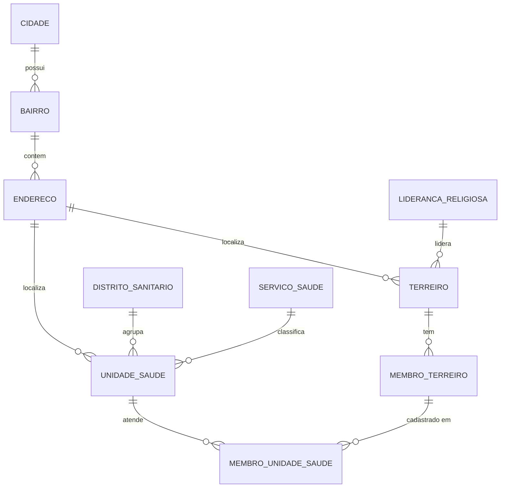

<div align="center">

# 🌿 Mapeamento de Terreiros e Unidades de Saúde
### Recife / PE


*Trabalho da disciplina de Banco de Dados — entregas SR1 + SR2*

</div>

---

## 📖 Sobre o projeto

Os **terreiros de religiões de matriz africana** são espaços de acolhimento e
cuidado para muitas comunidades da Região Metropolitana do Recife. Saber onde
eles ficam, quem são seus membros e qual unidade de saúde está mais próxima
ajuda a aproximar essas comunidades da rede pública de saúde.

Este trabalho propõe um **banco de dados que conecta esses dois mundos**:
ele registra os terreiros, suas lideranças e seus membros, e cruza essas
informações com as **unidades de saúde** (UBS, USF, policlínicas…) e os
**distritos sanitários** da cidade. Com isso é possível responder perguntas como:

- 📍 Quais unidades de saúde ficam no mesmo bairro de um terreiro?
- 🩺 Quais membros de terreiro já estão cadastrados em alguma unidade — e quais ainda não?
- 🏘️ Quais bairros têm terreiros mas nenhuma unidade de saúde (e vice-versa)?
- 📊 Quantos membros cada terreiro possui e qual a idade média deles?

Os endereços guardam **latitude e longitude**, deixando a base pronta para ser
usada em mapas e análises geográficas no futuro.

O sistema é composto por:

1. **Modelagem e scripts SQL** — criação das tabelas (DDL) e carga de dados (DML);
2. **12 consultas (DQL)** que cobrem todos os requisitos pedidos na disciplina;
3. **Uma aplicação desktop em Python + Tkinter** para criar o banco, rodar as
   consultas, cadastrar membros e executar SQL livre.

---

## 🗂️ Modelo de dados

O banco possui **10 tabelas** organizadas em três grupos: localização, saúde e terreiros.



| Grupo | Tabela | Descrição |
|---|---|---|
| 📍 Localização | `cidade` | Municípios da RMR e interior de PE |
| | `bairro` | Bairros de cada cidade |
| | `endereco` | Logradouro, CEP, latitude e longitude |
| 🏥 Saúde | `distrito_sanitario` | Distritos sanitários e sua RPA |
| | `servico_saude` | Tipo de serviço (sigla única, ex.: UBS, USF) |
| | `unidade_saude` | Unidades com telefone, horário e distrito |
| 🌿 Terreiros | `lideranca_religiosa` | Pais e mães de santo responsáveis |
| | `terreiro` | Nome, religião, nação, regente e ano de fundação |
| | `membro_terreiro` | Membros vinculados a cada terreiro |
| 🔗 Ligação | `membro_unidade_saude` | Associação N:N entre membros e unidades de saúde |

**Regras de integridade** aplicadas: chaves primárias com `AUTOINCREMENT`,
chaves estrangeiras (com `PRAGMA foreign_keys = ON`), `UNIQUE` em telefones,
e-mails e siglas, e `CHECK` em `ano_fundacao > 1500` e `regiao_rpa > 0`.

---

## 🚀 Como executar

> **Pré-requisito:** apenas o **Python 3** (Tkinter e SQLite já vêm incluídos).

```bash
python app.py
```

Na primeira execução, vá até a aba **1. Banco de Dados** e clique nos botões na ordem:

| Passo | Botão | O que acontece |
|:---:|---|---|
| 1 | `1) Criar Tabelas (DDL)` | Executa `scripts/criacao_tabelas.sql` |
| 2 | `2) Inserir Dados (DML)` | Executa `scripts/inserir_dados_tabelas.sql` |

O banco é salvo em `terreiros_saude.db`, na própria pasta do projeto.
O botão **Recriar Banco do Zero** apaga tudo e refaz os dois passos.

> [!IMPORTANT]
> As consultas `b3` e `b4` usam `RIGHT OUTER JOIN` e `FULL OUTER JOIN`, suportados
> pelo SQLite apenas a partir da versão **3.39** (já incluída no Python 3.12+).
> Para conferir a sua versão:
>
> ```bash
> python -c "import sqlite3; print(sqlite3.sqlite_version)"
> ```

---

## 🖥️ Funcionalidades da aplicação

| Aba | Para que serve |
|---|---|
| **1. Banco de Dados** | Executa os scripts DDL/DML e mostra quantos registros há em cada tabela |
| **2. Consultas (DQL)** | Lista as consultas do trabalho; ao selecionar, o SQL aparece num editor (pode ser alterado antes de rodar) e o resultado é exibido em tabela |
| **3. Cadastrar Membro** | Formulário que grava um novo membro de terreiro no banco (persistência de dados) |
| **4. SQL Livre** | Campo para digitar e executar qualquer comando SQL |

---

## 🔎 Consultas implementadas (requisito DQL)

| Item | Recurso SQL | O que a consulta mostra |
|:---:|---|---|
| **a** | `WHERE` | Terreiros fundados a partir de 2000 |
| **b1** | `INNER JOIN` | Terreiros com sua liderança e endereço |
| **b2** | `LEFT OUTER JOIN` | Membros e suas unidades de saúde (inclui quem não tem cadastro) |
| **b3** | `RIGHT OUTER JOIN` | Todas as cidades e seus terreiros |
| **b4** | `FULL OUTER JOIN` | Bairros com terreiros e/ou unidades de saúde |
| **c** | `GROUP BY` | Quantidade de membros por terreiro |
| **d** | `HAVING` | Unidades que atendem mais de 1 membro |
| **e** | `ORDER BY` | Terreiros do mais antigo ao mais novo |
| **f** | Funções numéricas | `COUNT`, `MIN`, `MAX`, `AVG`, `ROUND`, `ABS`, `SUM` por nação |
| **g** | Funções de texto | `UPPER`, `LOWER`, `SUBSTR`, `LENGTH`, `REPLACE`, `TRIM`, `INSTR` |
| **h** | Funções de data | `STRFTIME`, `JULIANDAY`, `DATE` — idade dos membros |
| **i** | `UNION` | Mapa geral reunindo terreiros e unidades de saúde |

---

## 📁 Estrutura do projeto

```
Projeto-GTI-3/
├── app.py                          # Interface gráfica (Tkinter)
├── banco.py                        # Conexão com o SQLite e execução de scripts/consultas
├── consultas.py                    # As 12 consultas DQL do trabalho
├── terreiros_saude.db              # Banco gerado pela aplicação
└── scripts/
    ├── criacao_tabelas.sql         # DDL — tabelas e constraints
    └── inserir_dados_tabelas.sql   # DML — carga de dados
```

---

<div align="center">

Feito com 💚 para a disciplina de Banco de Dados — CESAR School

</div>
